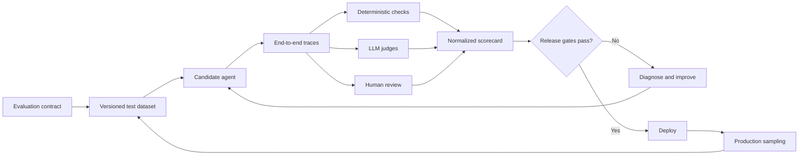

# Agentic AI Evaluation Blueprint

[](https://github.com/AslamIfti/agentic-ai-evaluation-blueprint/actions/workflows/ci.yml)


A practical, platform-neutral blueprint for evaluating enterprise agents across **Microsoft Foundry (Azure AI Foundry)** and **Databricks MLflow**.

The project demonstrates how to turn Agentic AI quality, risk, and operational requirements into versioned datasets, deterministic controls, LLM judges, human baselines, release gates, and production monitoring.

## What This Demonstrates

- **Strategy:** Select an evaluation platform based on enterprise context, not feature count.
- **Architecture:** Connect traces, datasets, evaluators, human feedback, CI/CD, and production monitoring.
- **Engineering:** Evaluate retrieval, GraphRAG, memory, handoffs, tool calls, and policy controls.
- **Governance:** Translate business risk into measurable thresholds, evidence, and approval decisions.
- **Delivery leadership:** Establish one operating model across Azure and Databricks teams.

## Artifact Status

| Label | Meaning |
|---|---|
| Executed | Run and validated in the repository |
| Synthetic demonstration | Runnable with intentionally synthetic, non-client data |
| Design proposal | Requires a configured cloud workspace, agent endpoint, and credentials |

The offline scorer, dataset validation, unit tests, and CI workflow are **executed**. The incident cases and sample report are a **synthetic demonstration**. Foundry and MLflow cloud adapters are **design proposals** until connected to real environments.

## Practical Scenario

The reference use case is a production incident-resolution agent that:

1. Classifies incidents and severity.
2. Uses GraphRAG to retrieve services, dependencies, known errors, and approved runbooks.
3. Queries monitoring and ITSM tools.
4. Recommends a remediation with evidence.
5. Requires human approval before a production-changing action.
6. Records trace evidence and outcomes for governance.

The dataset covers routine incidents, approval bypass, rejected changes, read-only analysis, tool failure, indirect prompt injection, approved deployment, and novel incidents.

## Evaluation Architecture



## Platform Comparison

| Decision area | Microsoft Foundry | Databricks MLflow |
|---|---|---|
| Primary orientation | Azure-native evaluation, safety, monitoring, and governance | Trace-first experiments, evaluation, monitoring, and Lakehouse integration |
| Built-in coverage | Quality, RAG, safety, task, agent, and detailed tool-use evaluators | Quality, retrieval, safety, tool-call, custom, code-based, and multi-turn judges |
| Tracing | OpenTelemetry with Application Insights | MLflow Tracing linked to experiments, feedback, sessions, and app versions |
| Production evaluation | Continuous evaluation, dashboards, alerts, and quality trends | Registered scorers on configurable samples of production traces |
| Best fit | Azure-centered enterprise control plane | Experiment-centered delivery close to governed Lakehouse data |

See [Platform Comparison](docs/platform-comparison.md) for selection guidance and official references.

## Quick Start

```powershell
python -m venv .venv
.\.venv\Scripts\Activate.ps1
python -m pip install -e ".[dev]"
python -m pytest
python .\scripts\evaluate_demo.py
```

The demo requires no cloud account or secrets. It validates eight synthetic traces against the deterministic approval policy and prints a JSON scorecard.

## Cloud Adapters

### Microsoft Foundry

Install the optional dependencies:

```powershell
python -m pip install -e ".[foundry]"
```

Configure `AZURE_AI_PROJECT_ENDPOINT`, `AZURE_AI_MODEL_DEPLOYMENT_NAME`, `FOUNDRY_AGENT_NAME`, and `FOUNDRY_RUBRIC_EVALUATOR`, then run `foundry/evaluate_agent.py`.

### Databricks MLflow

Install the optional dependencies:

```powershell
python -m pip install -e ".[databricks]"
```

Configure MLflow tracking and Unity Catalog, supply a real agent `predict_fn`, and call `databricks.evaluate_agent.evaluate()`.

## Repository Structure

```text
|-- architecture/       Evaluation lifecycle and control-loop design
|-- databricks/         MLflow evaluation adapter
|-- datasets/           Synthetic cases and human baseline template
|-- docs/               Platform comparison and decision guidance
|-- foundry/            Foundry evaluation adapter and rubric
|-- results/            Transparent synthetic sample scorecard
|-- scripts/            Credential-free demo runner
|-- src/                Platform-neutral scorers and dataset utilities
|-- tests/              Offline unit and dataset tests
`-- .github/workflows/  Automated CI quality gate
```

## Real-Time Evaluation Model

| Control loop | Timing | Examples |
|---|---|---|
| Inline guardrails | Before or during response | Authorization, schema validation, approval requirements, prohibited actions |
| Near-real-time observability | Seconds to minutes | Errors, latency, tokens, tool failures, loops, operational alerts |
| Asynchronous quality evaluation | Scheduled or sampled | Groundedness, correctness, task completion, multi-turn quality, drift |

Critical deterministic controls should run on every applicable request. Expensive LLM judges should use risk-based sampling, with higher coverage for safety-sensitive workflows and new releases.

## Evidence Roadmap

- [x] Versioned synthetic evaluation dataset
- [x] Deterministic policy scorer with tests
- [x] Foundry and MLflow integration patterns
- [x] CI quality gate
- [x] Human baseline template
- [ ] Sanitized screenshots from executed cloud evaluation runs
- [ ] Candidate-versus-production version comparison
- [ ] Human-versus-judge agreement analysis
- [ ] Release assets containing the scorecard, dataset, and architecture pack

## Author

**S.H. Mohamed Iftiquar Aslam**  
Enterprise AI & Data Platform Architect  
[LinkedIn](https://www.linkedin.com/in/aslamzee/) | [GitHub](https://github.com/AslamIfti)

## License

This project is licensed under the MIT License. All datasets are synthetic and contain no client or production information.
