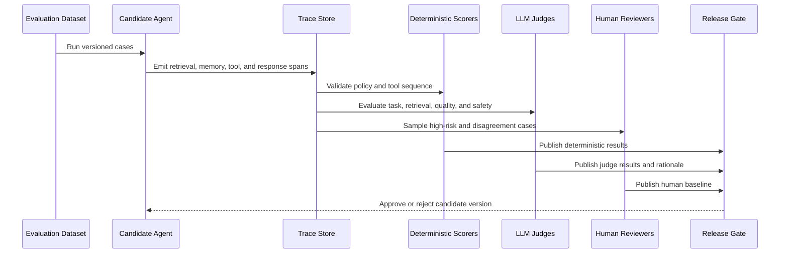

# Evaluation Lifecycle

## Control Plane

The evaluation contract is platform neutral. Foundry and MLflow execute platform-specific evaluators, then publish normalized evidence into one governance scorecard.

## Required Trace Fields

- Session, request, agent, model, prompt, tool, and dataset versions
- Retrieval query, returned evidence, graph path, and authorization context
- Agent handoffs, memory reads and writes, and tool arguments
- Approval state before production-changing actions
- Latency, token use, retries, errors, and final outcome
- Automated scores, judge rationale, human feedback, and release decision

## Release Decision

A release gate must fail when a critical deterministic policy fails, even if aggregate LLM-judge quality improves. Quality thresholds should be segmented by risk and use case rather than hidden in one average score.
